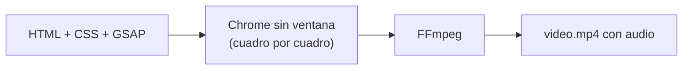
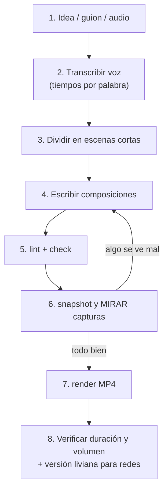

# Introducción a HyperFrames

> Guía rápida para entender qué es HyperFrames y cómo se hace un video con él.
> Versión usada en este estudio: **hyperframes 0.8.193** · Carpeta base: `D:\hyperframes-studio\`

---

## 1. ¿Qué es HyperFrames?

**HyperFrames** es una herramienta de código abierto de **HeyGen** que convierte **páginas HTML en videos MP4**.

En vez de animar en After Effects o Premiere, escribes:
- **HTML** → qué aparece en pantalla (textos, imágenes, canvas, video).
- **CSS** → cómo se ve (colores, fuentes, tamaños).
- **GSAP** (JavaScript) → cómo se mueve en el tiempo.

HyperFrames abre la página en un Chrome invisible, la avanza **cuadro por cuadro** y con **FFmpeg** junta todo en un MP4 con audio.



**¿Por qué sirve para canales sin rostro?**
- Todo es código → la IA puede escribir el video completo.
- Es **determinista**: el mismo código da siempre el mismo video.
- Cambiar un texto, un color o la voz es editar una línea y volver a generar.

---

## 2. Qué necesitas instalado

| Programa | Versión en esta PC | Para qué |
|---|---|---|
| Node.js | v24.20 (mínimo v22) | Ejecutar el CLI con `npx` |
| FFmpeg | 9.0.2 | Unir cuadros y audio en el MP4 |
| Chrome | lo descarga HyperFrames | Dibujar cada cuadro |

Comprobar que todo está bien:
```powershell
npx --yes hyperframes@0.8.193 doctor
```

Instalar FFmpeg en Windows (si faltara): `winget install Gyan.FFmpeg`

---

## 3. Tu primer video en 5 pasos

```powershell
cd D:\hyperframes-studio
npx --yes hyperframes@0.8.193 init mi-video              # 1. crear proyecto (16:9)
# npx hyperframes init mi-video --resolution portrait    #    (o vertical 9:16)
cd mi-video
# 2. editar index.html y compositions/*.html
npx --yes hyperframes@0.8.193 preview                    # 3. ver en vivo en el navegador
npx --yes hyperframes@0.8.193 check --json               # 4. buscar errores
npx --yes hyperframes@0.8.193 render --output mi-video.mp4   # 5. generar el MP4
```

---

## 4. Estructura de un proyecto

```
mi-video/
├── index.html            ← la "raíz": duración total, escenas y audios
├── compositions/         ← una escena por archivo (sub-composiciones)
│   ├── intro.html
│   └── captions.html
├── assets/               ← imágenes, fuentes, sonidos, voz
│   ├── sfx/
│   └── voice/
├── hyperframes.json      ← configuración del proyecto
└── package.json
```

---

## 5. Los conceptos clave

### 5.1 Composición
Una **composición** es un bloque HTML con su propia línea de tiempo. La raíz (`index.html`) es la composición principal y monta las demás.

```html
<div id="root" data-composition-id="main" data-width="1920" data-height="1080" data-duration="10">
  ...
</div>
```
- `data-duration` de la raíz = **duración total del video** (lo que sobra se corta).

### 5.2 Clips (elementos con tiempo)
Todo lo que aparece y desaparece es un **clip**:

```html
<div id="titulo" class="clip" data-start="1.5" data-duration="3">¡Hola!</div>
```
| Atributo | Significado |
|---|---|
| `class="clip"` | Marca el elemento como clip |
| `data-start` | Segundo en que aparece |
| `data-duration` | Cuántos segundos dura |
| `data-track-index` | Carril en el editor (no afecta el orden de dibujo) |
| `z-index` (CSS) | Qué queda encima de qué |

### 5.3 Sub-composiciones (escenas)
Cada escena va en su archivo dentro de `<template>`:

```html
<!-- compositions/intro.html -->
<template>
  <style>
    #root { position: absolute; inset: 0; background: #0e0b0a; }
  </style>
  <div id="root" data-composition-id="intro" data-width="1920" data-height="1080">
    <h1 id="intro-title">Hola</h1>
  </div>
  <script>
    const tl = gsap.timeline({ paused: true });
    tl.from("#intro-title", { y: 80, opacity: 0, duration: 0.6, ease: "power3.out" }, 0);
    window.__timelines["intro"] = tl;
  </script>
</template>
```

Y se monta desde la raíz:
```html
<div id="intro" class="clip" data-start="0" data-duration="4"
     data-composition-src="compositions/intro.html" data-track-kind="graphics"></div>
```

### 5.4 La línea de tiempo GSAP
- Cada composición crea **una** línea de tiempo **en pausa**: `gsap.timeline({ paused: true })`.
- Se registra al final: `window.__timelines["<data-composition-id>"] = tl`.
- HyperFrames la mueve cuadro a cuadro; **tú nunca la reproduces**.

### 5.5 Audio
```html
<audio id="voz" class="clip" src="assets/voice/narracion.mp3" data-start="0" data-duration="30"></audio>
<audio id="golpe1" class="clip" src="assets/sfx/whoosh.mp3" data-start="2.4" data-duration="0.8"></audio>
```
- Cada `<audio>` necesita `id` (si no, no suena).
- Nunca usar `play()` / `pause()`; HyperFrames lo controla.

---

## 6. Las reglas de oro

1. **Todo depende del tiempo de la línea de tiempo.** Prohibido `Date.now()`, `setTimeout`, `Math.random()` sin semilla, `repeat: -1` o cargar cosas de internet.
2. **Una propiedad, una animación a la vez.** No solapar dos tweens sobre lo mismo.
3. **No animar `display` ni `visibility`** de un `.clip`; anima un hijo.
4. **Mover con `transform`** (x, y, scale), no con `left/top/width`.
5. **Rutas relativas a la raíz**: `assets/...`, también dentro de las escenas.
6. **Fuentes**: solo las incluidas resuelven por nombre (Montserrat, Archivo Black, Inter…); otras van con `@font-face` desde `assets/fonts/`.
7. **El cuadro 0 no debe estar vacío** (es la miniatura).
8. En esta PC: **no usar `data-motion-blur`** (la GPU Intel hace desaparecer el texto).

---

## 7. Comandos más usados

| Comando | Para qué |
|---|---|
| `init <nombre>` | Crear proyecto (`--resolution portrait` = vertical) |
| `preview` | Ver el video en vivo y editarlo |
| `lint` | Revisión rápida de errores comunes |
| `check --json` | Revisión completa (errores + diseño + tiempo) |
| `snapshot --at 1,3.5,8` | Capturas PNG en esos segundos + hoja de contacto |
| `render --output x.mp4` | Generar el MP4 (`--quality delivery` = máxima calidad) |
| `transcribe <audio> --engine parakeet --language es` | Texto con tiempo por palabra (para subtítulos) |
| `audio <archivo> --json` | Volumen, picos y silencios de un audio o video |
| `timeline --json` | Qué suena y se ve en cada momento |
| `catalog` / `add` | Bloques ya hechos (transiciones, subtítulos, gráficos) |
| `open` | Abrir el proyecto en la app de escritorio de HyperFrames |

> Siempre con versión fija: `npx --yes hyperframes@0.8.193 <comando>`

---

## 8. Flujo de trabajo recomendado



Versión liviana para TikTok/Reels/Shorts:
```powershell
ffmpeg -i video.mp4 -c:v libx264 -crf 25 -preset slow -pix_fmt yuv420p -c:a aac -b:a 160k -movflags +faststart video-redes.mp4
```

---

## 9. Dos formas de animar

| Forma | Cuándo | Ejemplo en este estudio |
|---|---|---|
| **DOM + GSAP** (divs, textos, imágenes) | Tipografía, tarjetas, interfaces, subtítulos | `claude-bestia/` (tipografía cinética) |
| **Canvas 2D** dibujado en función del tiempo | Personajes, ilustración, partículas | `irena-sendler/` (stickman), `irena-titere/` (títere de papel) |

Truco del canvas: un tween "reloj" que llama a tu función de dibujo:
```js
const clock = { t: 0 };
tl.fromTo(clock, { t: 0 }, { t: END, duration: END, ease: "none", onUpdate: () => renderAt(clock.t) }, 0);
```

---

## 10. Formatos

| Formato | Tamaño | Para |
|---|---|---|
| Horizontal 16:9 | 1920×1080 | YouTube |
| Vertical 9:16 | 1080×1920 | TikTok, Reels, Shorts |
| Cuadrado 1:1 | 1080×1080 | Feed de Instagram |

Volumen recomendado para redes: **unos −14 LUFS**, sin pasar de −1 dB de pico.

---

## 11. Dónde seguir leyendo

| Archivo | Contenido |
|---|---|
| [CONTEXTO.md](CONTEXTO.md) | Resumen del estudio, entorno y lecciones aprendidas |
| [ESTILOS.md](ESTILOS.md) | Estilos guardados: Stickman y Títere de papel |
| `.agents/skills/hyperframes/SKILL.md` | Reglas oficiales de HyperFrames |
| `.agents/skills/hyperframes/references/` | Guías por tema: subtítulos, sonido, movimiento, 3D, datos… |
| `.agents/skills/hyperframes-cli/` | Todos los comandos del CLI |
| `.agents/skills/hyperframes-registry/` | Bloques y efectos ya hechos |
| `npx hyperframes docs` | Documentación en la terminal |

### Proyectos de ejemplo en esta carpeta
- `claude-bestia/` → tipografía cinética 16:9 con golpes y sonidos.
- `irena-sendler/` → historia narrada, stickman, vertical con subtítulos karaoke.
- `irena-titere/` → la misma historia en estilo títere de papel stop-motion.
